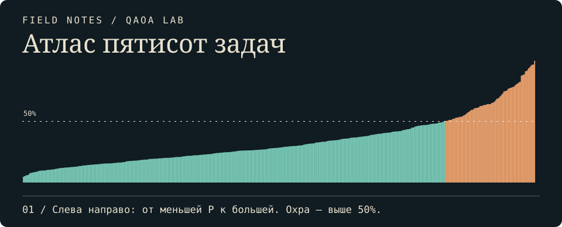
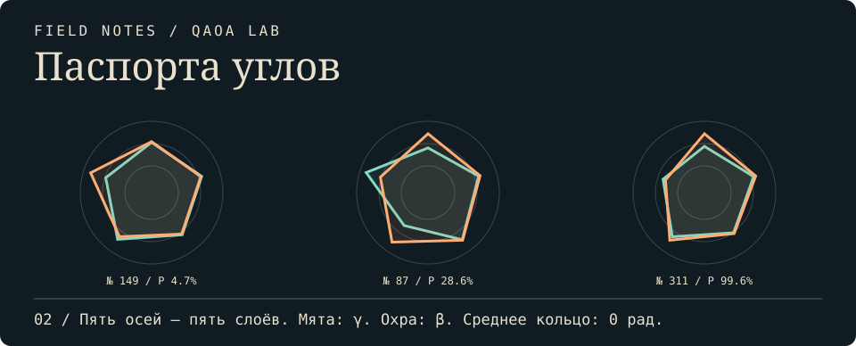

# QAOA · Поиск углов для квантовой оптимизации

[](assets/atlas.svg)

**Хакатон Сбера · 12 кубитов · Python / PyTorch**

Как настроить квантовую схему, чтобы при измерении чаще получать состояние с минимальной энергией? В этом проекте для каждой задачи подбираются десять углов: по два на каждый из пяти слоёв QAOA. Качество проверяется точным симулятором, без квантового компьютера.

[Презентация решения (PDF)](presentation.pdf) · [Разбор в ноутбуке](solution_final.ipynb) · [Код симулятора](QAOA.py)

## Что получилось

На 500 задачах открытого набора средняя вероятность найти основное состояние составила **33,80%** против **0,60%** у случайных углов. В 88 задачах вероятность превысила 50%. Это оценка углов из [`merged2.csv`](merged2.csv) на `h_train`, а не оценка на скрытом тесте.

1. **Поиск.** Сканируем семейства углов и уточняем кандидатов локальным поиском.
2. **Отбор.** Для каждой задачи отдельно сохраняем углы с наибольшей вероятностью успеха: один набор не обязан подходить всем.
3. **Перенос.** Для новой задачи берём углы восьми похожих задач за начальную точку и уточняем их с помощью Adam. На весь тестовый набор по условиям отведено десять минут.

## Лабораторный журнал

[**Войти в интерактивный атлас →**](https://raw.githack.com/overbaffe1/QAOA/main/studio/index.html) · [3D-лаборатория →](https://raw.githack.com/overbaffe1/QAOA/main/qaoa_viz.html)

**01 / Прочитать сигнал.** На обложке задачи отсортированы по вероятности успеха. В атласе те же 500 штрихов стоят по ID: выбери один, чтобы увидеть его результат и все десять углов. Кнопки минимума, середины и максимума позволяют сравнить три характерных случая.

[](assets/orbits.svg)

**02 / Сравнить схемы.** У каждого портрета верхняя ось — первый слой, дальше слои идут по часовой стрелке. Чем больше угол, тем дальше вершина от центра; отрицательные значения лежат внутри среднего кольца. Форма показывает параметры схемы, а не вероятность — она подписана отдельно.

**03 / Изменить эксперимент.** В 3D-лаборатории выбери задачу и два угла: высота поверхности показывает, как меняется вероятность при фиксированных остальных углах. Атлас показывает сохранённый результат, а лаборатория позволяет менять параметры.

Без внешнего сервиса: скачай репозиторий и открой `studio/index.html` в браузере. Снимок `viz_data.js` уже включён. Чтобы пересчитать снимок и обе иллюстрации из исходных данных, выполни `python make_viz_data.py`, затем `python studio/build_prints.py` из корня.

## Данные

| файл | что это |
|---|---|
| `J.npy` | матрица взаимодействий 12×12 (одна на все инстансы) |
| `h_train.npy` | 500×12: линейные коэффициенты Гамильтониана каждого инстанса (лидерборд) |
| `h_test.npy` | инференс-набор (для финальной submission) |
| `merged2.csv` | лучший CSV углов: `id,gamma_0..4,beta_0..4` (mean 0.3380) |

Энергия состояния `s∈{±1}^12`: `E(s) = 0.5·sᵀJ s + h·s`. «Основное» — состояние с
минимальным E (при вырождении — все минимумы; P суммируется по ним).

## Запуск

Из корня репозитория, с Python 3.10+:

```bash
python -m pip install -r requirements.txt
python score_csv.py merged2.csv
```

| задача | команда |
|---|---|
| **Оценить любой CSV углов** | `python score_csv.py merged2.csv` (или `score_csv.py a.csv b.csv` — сравнение + ratchet-выигрыши) |
| **Рейтинг всех CSV в папке** | `python scan_best.py` |
| **Часовой улучшатель** (координатный спуск по худшим инстансам, GPU) | `python polish_worst.py --ref merged2.csv --minutes 55` → `polish_ratchet.csv` |
| **Лотерея** (фоновый, ratchet-копилка) | `python lottery.py --h h_train.npy --ref merged2.csv --sets 5000` |
| **Инференс h_test → углы** (финал, ≤10 мин) | `python knn_warm.py --h h_test.npy --targets merged2.csv --out submission_knn.csv` |
| Проверка инференса на train (LOO-аналог) | `python knn_warm.py --h h_train.npy --targets merged2.csv --out _selfcheck_train.csv` |
| 3D-визуализация (гора, 500 точек, 500 гор, workers) | `python make_viz_data.py` → открыть `qaoa_viz.html` в браузере |

## Ключевые файлы

- `QAOA.py` — точный симулятор: `QAOA` (эталон) и `FastQAOA` (group=4, ~5× быстрее,
  совпадает с эталоном до 1e-9). `p_ground(h, gamma, beta)`.
- `score_csv.py` — точный скорер CSV углов (mean/>0.5/top-15, сравнение двух CSV).
- `scan_best.py` — рекурсивный рейтинг всех CSV-файлов углов в папке.
- `polish_worst.py` — детерминированный координатный спуск по худшим инстансам
  (сетки ±0.5→±0.015, ratchet; ~55 мин на GPU; результат `polish_ratchet.csv`).
- `lottery.py` — массовый поиск случайных наборов (семейства informed/uniform/wide)
  с persistent-ratchet (`lotto_ratchet.csv` = лучший из (ref + все сиды) по каждому
  инстансу) и ledger сидов (`lotto_top.csv`, `lotto_all.csv`).
- `knn_warm.py` — финальный инференс: для каждого `h_test` — K=8 ближайших `h_train`
  (знаковая метрика, P(h)=P(−h)), их углы из targets, jitter-копии + Adam-довжим,
  лучший результат. ~5-9 мин на GPU.
- `solution/` — pipeline «мозга» (features → model → train/distill/infer, brain.pkl).
- `qaoa_viz.html` — 3D-визуализация: гора P(инстанса),
  500 точек, режим «500 гор» (workers), полёт WASD, копирование строк углов.
- `presentation.pdf` — презентация решения.
- `solution_final.ipynb` — закомментированный ноутбук: задача → симулятор → методы →
  результаты → инференс.
